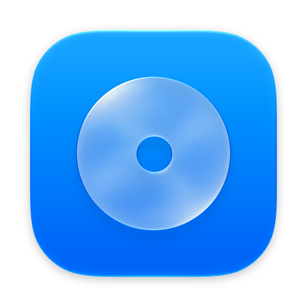
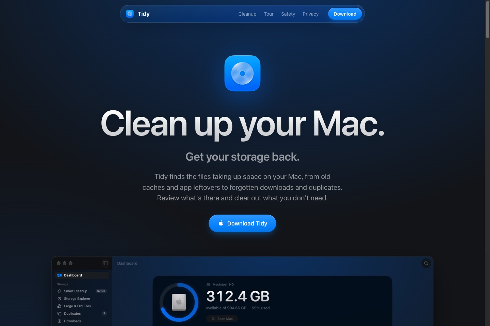
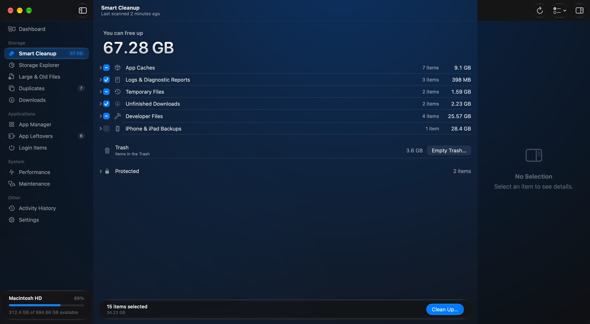
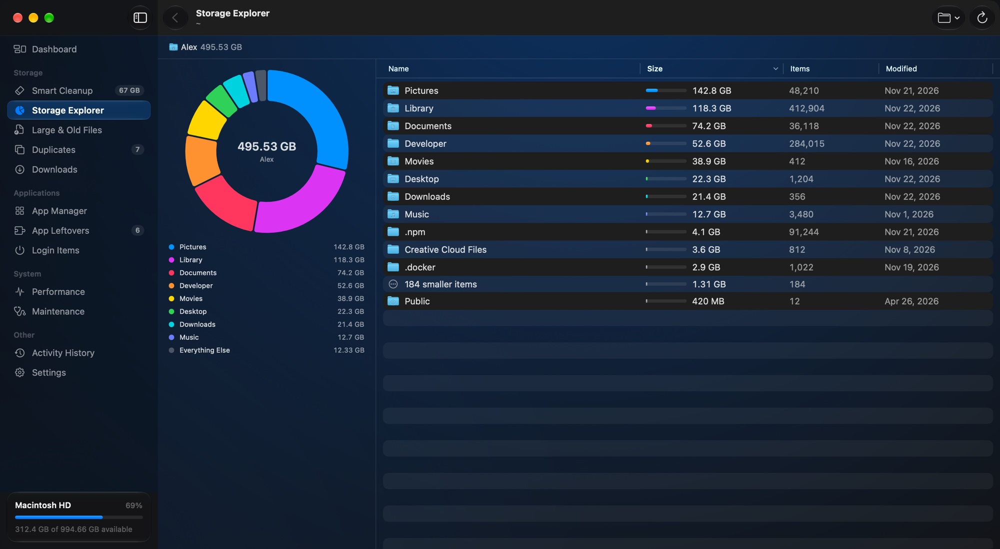
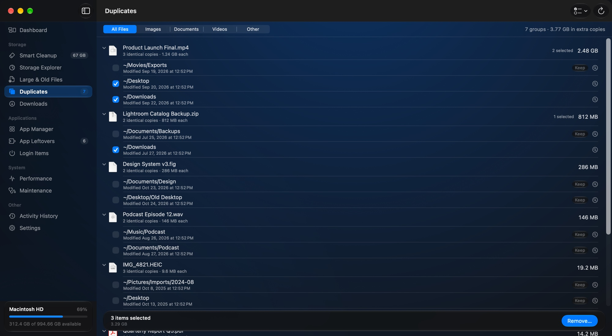
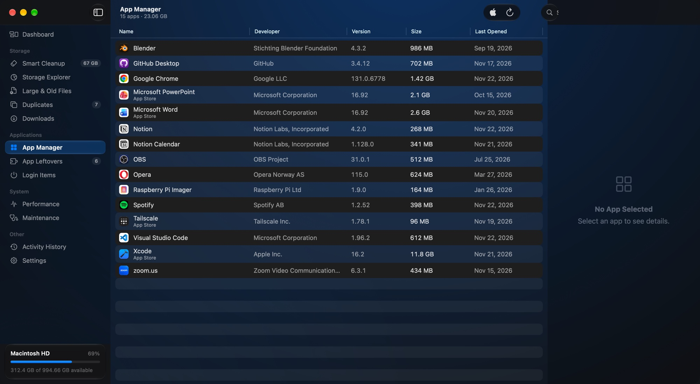

<div align="center">

<a href="__SITE__">
  
</a>

## Tidy

### Clean up your Mac. Get your storage back.

Tidy finds the files taking up space on your Mac, from old caches and app leftovers to forgotten downloads and duplicates. Review what's there and clear out what you don't need.

[**Download**](../../releases/latest/download/Tidy.zip) · [Website](__SITE__) · [Safety](#safety) · [Install](#install) · [Report an issue](../../issues)


</div>

---

<p align="center">
  
</p>

## Features

- **Smart Cleanup.** One scan across app caches, logs, temporary files, unfinished downloads, developer data, device backups and the Trash. Every item is marked Recommended, Review Required or Protected, with a reason.
- **Storage Explorer.** A drill-down chart next to a sortable table. Find the folders taking the most room, preview with Quick Look, and move things to the Trash.
- **Duplicates.** Matched by size, then a fingerprint, then a full SHA-256. One copy in every group is always kept.
- **Large & Old Files.** Filter by size, kind and when you last opened them.
- **Downloads.** Old installers, disk images and archives, with the site each one came from.
- **App Manager and App Leftovers.** See every app's size and last opened date, uninstall with its related files, and clear data left behind by apps you already deleted.
- **Login Items, Performance and Maintenance.** See what runs at login and in the background, check CPU and memory, and run disk health checks.
- **Activity History.** Everything Tidy moved, with Put Back.

| | |
| :---: | :---: |
|  |  |
| Smart Cleanup | Storage Explorer |
|  |  |
| Duplicates | App Manager |

Screenshots use sample data.

## Install

1. Download `Tidy.zip` from the [latest release](../../releases/latest).
2. Drag **Tidy.app** into **Applications** and open it.
3. Run a scan from the Dashboard.

> [!IMPORTANT]
> Tidy is not notarized yet. The first time, right-click **Tidy.app** and choose **Open**. On macOS 15 and later, use **System Settings > Privacy & Security > Open Anyway**.

Requires macOS 15 or later. Universal binary for Apple Silicon and Intel. Liquid Glass on macOS 26 and later.

## Safety

1. Every item is classified as **Recommended**, **Review Required** or **Protected**. Only Recommended items start selected.
2. Every removal shows an itemized review first. Permanent deletion always asks.
3. Each item is checked again at the moment of removal. System paths, SIP-protected and locked files, essential folders and Tidy itself are refused. Symlinks are removed as links, never followed.
4. Files that belong to an app that's running are left alone.
5. Removal defaults to **Move to Trash**, and apps always go to the Trash. Activity History can put items back.
6. For duplicates, the copy you keep is verified on disk before any other copy is removed.

## Privacy

No network access, no account, no analytics. Tidy reads your disk locally and never asks for an administrator password or for System Integrity Protection to be turned off. Activity History lives in `~/Library/Application Support/Tidy/`.

| Permission | Required? | Used for |
| --- | --- | --- |
| Documents, Desktop, Downloads | Asked when needed | Category sizes, large and duplicate files, Downloads |
| Full Disk Access | Optional | The Trash, app containers and device backups. Without it, Tidy skips them and says so. |
| Automation (Finder, System Events) | Only when you ask | Emptying the Trash, listing apps that open at login |

> [!NOTE]
> **Why Tidy isn't sandboxed.** A cleanup app has to read `~/Library/Caches`, `~/Library/Logs`, other apps' preferences and `/Applications`. App Sandbox blocks all of these, so Tidy ships outside the Mac App Store with the Hardened Runtime.

## Known limitations

- Processes owned by other users can't be inspected without root, so Performance shows your processes and links to Activity Monitor.
- macOS has no public API to toggle other apps' login items, so Tidy links to System Settings.
- Sizes are on-disk sizes. APFS clones can be counted more than once, so removing one may free less than shown.
- Space from items in the Trash comes back when the Trash is emptied.

## Build

Requires Xcode 26 or later. No third-party packages.

```bash
open Tidy.xcodeproj                                        # then press ⌘R
xcodebuild -project Tidy.xcodeproj -scheme Tidy -configuration Release -derivedDataPath build build
```

| Launch argument (Debug builds) | Effect |
| --- | --- |
| `-TidyDemo YES` | Fills every screen with sample data. Nothing is scanned or removed. |
| `-TidySnapshotDir <dir>` | Renders each screen to a PNG, then quits |
| `-TidyAppearance dark` | Forces Dark or Light Mode for snapshots |

```
Tidy/App/         App entry, app model, settings, sidebar, demo data
Tidy/Services/    Scanners and system access: safety policy, remover, cleanup, storage tree, duplicates, apps
Tidy/Views/       One folder per screen, each with its own model
Tidy/Components/  Storage bar, review sheet, file actions, glass helpers
Tools/            App icon fitting script
website/          Landing page (static, deployed on Vercel)
docs/             README images
```

## Release

```bash
xcodebuild -project Tidy.xcodeproj -scheme Tidy -configuration Release -derivedDataPath build ONLY_ACTIVE_ARCH=NO ARCHS="arm64 x86_64" build
ditto -c -k --keepParent build/Build/Products/Release/Tidy.app Tidy.zip
gh release create v<version> Tidy.zip --title "Tidy <version>" --notes-file notes.md
```

The website's Download buttons link to `releases/latest/download/Tidy.zip`, so a new release updates them automatically.
